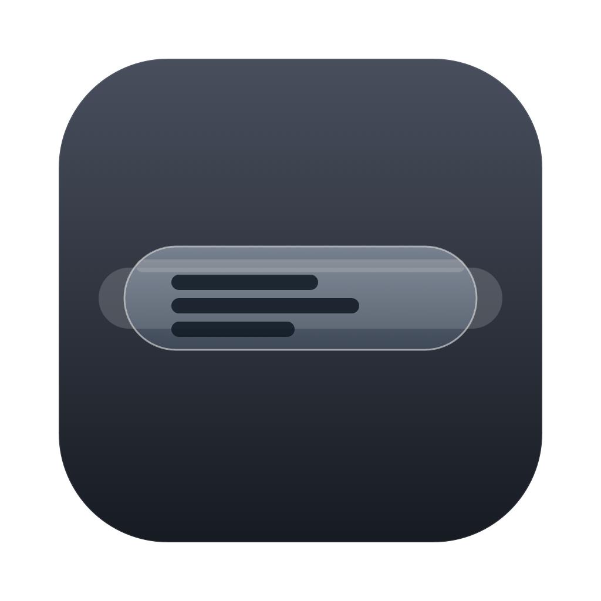

<div align="center">

  

  <h1>MenuTitle</h1>

  <p><b>The focused window's title, in your menu bar.</b></p>

  <p>
    Native Swift. Reads yabai. Fits around your app menus.<br/>
    No Dock icon, no window clutter.
  </p>

  <p>
    <a href="https://github.com/wiggly-sheets/menutitle/actions/workflows/ci.yml"></a>
    <a href="https://github.com/wiggly-sheets/menutitle/blob/main/LICENSE"></a>
    <a href="https://github.com/wiggly-sheets/menutitle/releases/latest"></a>
    <a href="https://github.com/wiggly-sheets/menutitle/releases"></a>
    <a href="https://github.com/wiggly-sheets/menutitle/stargazers"></a>
  </p>

  <p>
    <a href="https://github.com/wiggly-sheets/menutitle/releases/latest"><b>Download</b></a>
    &nbsp;·&nbsp;
    <a href="#installation">Install guide</a>
    &nbsp;·&nbsp;
    <a href="#build-from-source">Build from source</a>
    &nbsp;·&nbsp;
    <a href="#requirements">Requirements</a>
  </p>

</div>

---

MenuTitle shows the title of the focused window next to the front app's menus. It asks [yabai](https://github.com/koekeishiya/yabai) for the window, measures the native menus through Accessibility, and draws a small floating panel in the remaining space.

The title moves as menus change width and stops before the notch or the next menu bar item. During an app switch it clears out, then fades in after the new app's menus settle. When there is not enough room, it can shorten, shrink, or scroll the title instead of covering something else.

> [!NOTE]
> MenuTitle needs Accessibility access to measure the menu bar and read the front app's menus. Without it, the title stays hidden rather than guessing a position.

---

## Features

### Follows the focused window

- Shows the app name's icon and the focused window title from yabai.
- Updates instantly when the focused window or its title changes, with a 3-second poll as fallback.
- Hides in native fullscreen spaces and when no titled window has focus.
- Stays out of the way while a menu bar menu is open, then returns and keeps the front app focused.
- Hides while Mission Control or Exposé is on screen, then returns when it closes.

### Fits around the menu bar

- Measures where the front app's menus end and places the title after them.
- Stops at the MacBook notch.
- Stops at other menu bar windows, such as always-on-top widgets.
- Can be dragged anywhere on screen and locked in place.
- Can also live as a regular menu bar item on the right side. Show it alone, or show both title and item.

### Title handling

- Shorten long titles at the beginning, middle, or end.
- Cap the title by character count.
- Scroll long titles instead of shortening them, with a speed setting.
- Shrink the font before shortening.
- Optionally strip browser names and profile suffixes. Browsers are detected from the focused app and its link handlers, so new browsers work without a list. Add custom suffixes for the rest.

### Appearance

- Icon styles: sketchybar app font glyph, native app icon, or no icon.
- Background styles: liquid glass, solid, transparent, or outline.
- Custom text and background colors.
- Background opacity, corner radius, and extra vertical inset.
- Padding on all four sides of the background, linked or set per side.
- Font family, style, and size through the native macOS font panel.
- Letter spacing, word spacing, and max width.
- Sidebar settings with a pane for each group.

### Clicks

- Separate left, middle, and right click actions.
- Actions per target: open settings, show the MenuTitle menu, focus the app, hide it, minimize it, or quit it.
- The menu bar item can mirror the title's click actions or use its own.

### General

- Launch at login.
- Accessibility permission status and a Grant button that opens the right settings pane.
- Ad-hoc signed, open source, and fully local.

---

## Download

<div align="center">

<a href="https://github.com/wiggly-sheets/menutitle/releases/latest"></a>

</div>

---

## Installation

There are two ways to install MenuTitle: with Homebrew, or by downloading the app directly. Both land in the same place.

### Install with Homebrew

```bash
brew install --cask wiggly-sheets/homebrew-tap/menutitle
```

This taps the repository and installs MenuTitle in one step. Homebrew verifies the download's checksum for you.

### Install manually

#### Step 1: Download

Download the latest `.dmg` from the [releases page](https://github.com/wiggly-sheets/menutitle/releases/latest).

#### Step 2: Verify your download (optional but recommended)

Each release includes a matching `.dmg.sha256` checksum file. Download both the `.dmg` and its `.dmg.sha256` file into the same folder, then in Terminal:

```bash
cd ~/Downloads
shasum -a 256 -c MenuTitle-*.dmg.sha256
```

A result ending in `OK` means the file matches the published release.

#### Step 3: Install

Open the `.dmg` and drag **MenuTitle** to your Applications folder.

#### Step 4: Open MenuTitle

MenuTitle is ad-hoc signed and not notarized. macOS may block the first launch. If it does, open it through **System Settings → Privacy & Security**, right-click the app, and choose **Open**.

You can also remove the quarantine attribute:

```bash
xattr -dr com.apple.quarantine /Applications/MenuTitle.app
```

Only run that command for apps you downloaded from a source you trust.

#### Step 5: Grant Accessibility access

MenuTitle needs Accessibility access to measure the menu bar and read window titles through yabai. On launch, it explains this with a prompt that opens the right settings pane.

1. Open MenuTitle's settings and click **Grant…** in the **Permissions** pane.
2. Enable **MenuTitle** under **System Settings → Privacy & Security → Accessibility**.
3. The title appears within a second; no relaunch needed.

---

## Updating

### Updating with Homebrew

```bash
brew upgrade --cask menutitle
```

Your settings stay in place.

### Updating a manual download

1. Download the latest `.dmg` from the releases page.
2. Open it and drag **MenuTitle** into Applications.
3. Choose **Replace** when asked.

MenuTitle uses an ad-hoc signature, which changes on every rebuild. macOS may ask for Accessibility access again after an update. Re-enable MenuTitle in **System Settings → Privacy & Security → Accessibility** if the title stops appearing.

---

## Build from source

Prefer to build MenuTitle yourself instead of downloading the release? Here is how.

### Prerequisites

- macOS 14 or later
- **Xcode 26 or later** with the macOS 26 or later SDK
- Swift 5.9 or later, included with Xcode

The app runs on macOS 14 or later. Building needs the macOS 26 SDK for the liquid glass API; runtime availability still falls back to a standard blur on older systems.

### Step 1: Clone the repository

```bash
git clone https://github.com/wiggly-sheets/menutitle.git
cd menutitle
```

### Step 2: Build and run

```bash
make run
```

`make` prints every target. `make test` runs the changelog check and the test suite. `make app` builds `dist/MenuTitle.app`, and `make verify` checks its architecture, SDK, version, and signature.

To build without launching:

```bash
make app CONFIGURATION=release
```

### Step 3: Run the tests

```bash
make test
```

### Release build

```bash
make release VERSION=1.0.0
git push origin main
git push origin v1.0.0
```

`make release` moves `[Unreleased]` in `CHANGELOG.md` to the version, runs the tests, builds the DMG and its checksum, verifies the bundle, commits the bump, and creates the tag. It never pushes. Pushing the tag starts the release workflow, which publishes `MenuTitle-<version>.dmg` and its `.sha256` file. The Homebrew tap picks up that release.

---

## Requirements

- macOS 14 or later
- [yabai](https://github.com/koekeishiya/yabai) running with window titles queryable
- Accessibility access for MenuTitle
- Apple Silicon for the published builds

The title is positioned through the Accessibility API. Without access, MenuTitle hides the title rather than guessing.

---

## Privacy

MenuTitle runs entirely on your Mac.

- It reads the focused window from yabai and the front app's menu bar through Accessibility.
- It stores its settings in `UserDefaults`.
- It does not collect analytics, send titles anywhere, or contact a server. Update checks are left to Homebrew or the releases page.

---

## Security

MenuTitle asks for Accessibility access, which is broad. A few things worth knowing:

- **Local only**: no network calls, no telemetry, no remote logging.
- **Narrow use**: Accessibility is used to read the front app's menu bar geometry and to update the title.
- **Open source**: the full source is in this repository, so you can read or build it yourself.
- **Ad-hoc signed**: not notarized. Verify the checksum and review the code before granting access.

Found a security issue? Open an issue or contact the maintainer privately.

---

## Notes and limits

- Only yabai's focused window is shown. A space with no focused window has no title.
- The custom position is saved for each display.
- MenuTitle checks for yabai at launch. Without it, the app explains what to install and then quits.
- The menu bar item hides when the front app is MenuTitle itself or when Accessibility access is missing.
- MenuTitle is an accessory app: no Dock icon and no app menu of its own.
- If sketchybar still shows its `window_title` item in the same area, the two overlap. Remove that item or use the **Left inset** setting.

---

## License

MenuTitle is released under the [MIT License](LICENSE). You are free to use, read, modify, and distribute it.

---

## Support

Questions, bugs, and feature requests belong in [GitHub Issues](https://github.com/wiggly-sheets/menutitle/issues).

<div align="center">

**[wiggly-sheets](https://github.com/wiggly-sheets)**

</div>
